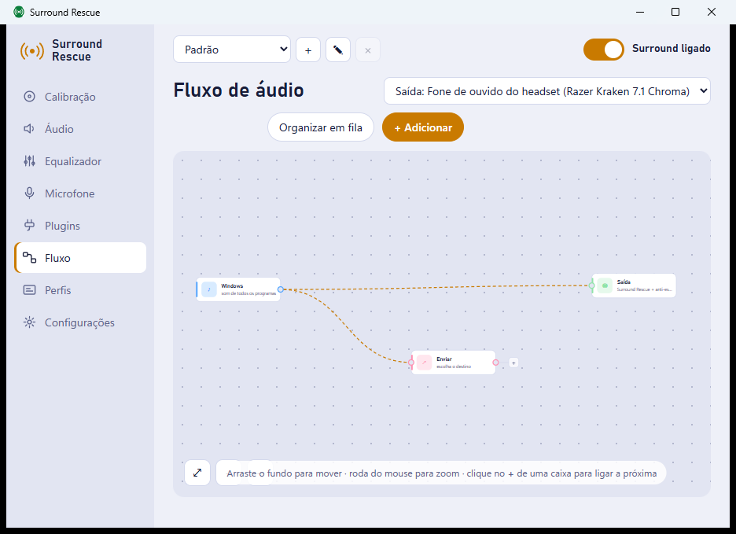
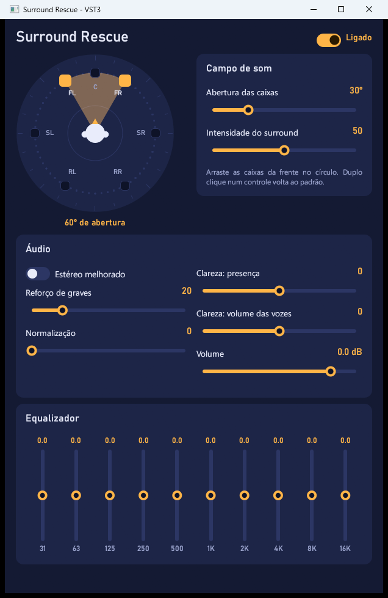
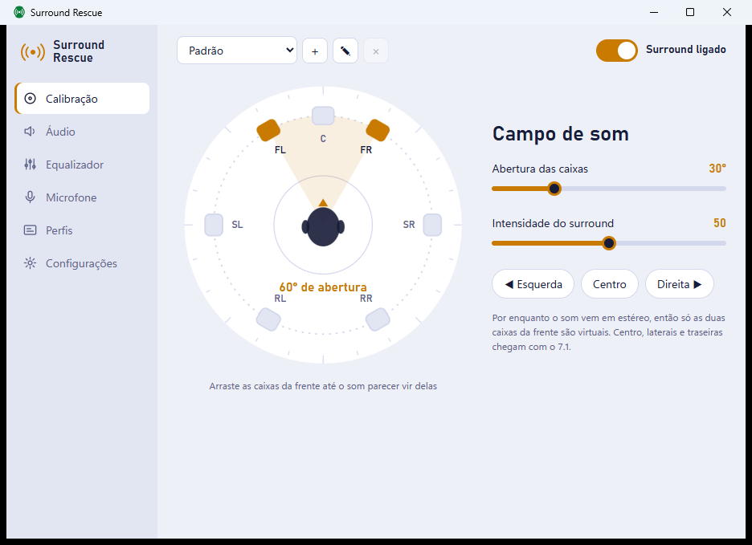
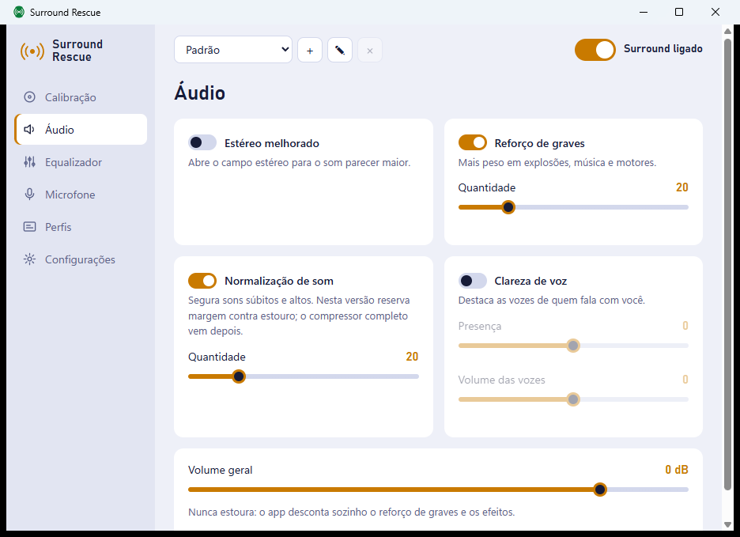
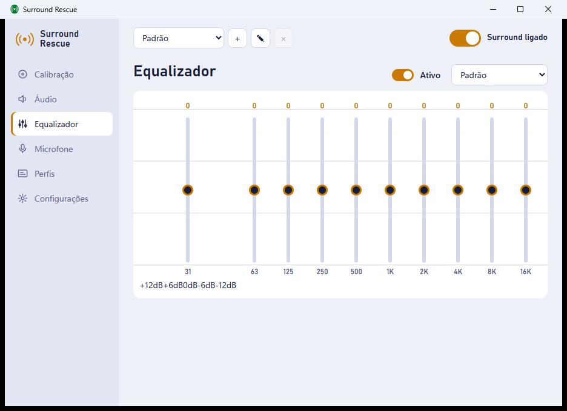

# Surround Rescue

**Uma mesa de som em software para o Windows.** Pegue o som de qualquer programa, microfone ou saída, trate com efeitos e plugins VST3, misture, e mande para onde quiser — tudo num editor visual de caixas e setas, com o motor rodando dentro do próprio áudio do Windows.



> **Projeto independente.** Não tem ligação com a Razer Inc. nem com a Nahimic/A-Volute. Os nomes aparecem só para contar de onde o projeto veio e descrever compatibilidade.

> **Estado: experimental.** Funciona e foi testado em uso real, mas mexe no caminho de áudio do Windows. Leia [Como desfazer](#como-desfazer) antes de instalar.

---

## De onde veio

Começou com um problema simples: o **Razer Surround** (o som 7.1 virtual dos headsets Razer) foi descontinuado e, no Windows 11, funciona mal. Programas como o Discord não entravam no processamento, era preciso trocar o dispositivo várias vezes até "pegar", e enquanto isso o som saía **estourado**.

Estudando a instalação, descobrimos o porquê:

- o Razer Surround é um motor da **Nahimic** com outra marca, que depende de um **dispositivo virtual** e de um **serviço** que trava;
- o driver do headset ainda traz um processador Nahimic próprio, que sem o serviço fica com graves, compressor e surround **fixos** — daí o som estourado;
- os programas acabavam tocando direto no fone, fora do processamento.

A primeira versão resolveu isso com um app próprio por cima do Equalizer APO. Depois veio um **motor próprio dentro do Windows** (um APO escrito em Rust), plugins VST3, um editor de fluxo… e o projeto deixou de ser "o substituto do Razer Surround".

## No que ele virou

Uma **mesa de som de software** — o tipo de ferramenta que sonoplastas, streamers e técnicos de som usam para rotear e tratar áudio, só que:

- **dentro do Windows**, sem cabo virtual nem dispositivo falso para o efeito principal: o processamento acontece no caminho de áudio do próprio dispositivo, para todos os programas, **sem somar atraso**;
- **visual**: cada fonte, efeito e destino é uma caixa; você liga com setas, como num editor de nós;
- **aberto a qualquer plugin VST3**: o que existir de efeito no mercado vira efeito do sistema inteiro;
- **com qualquer dispositivo**: fones, caixas, microfones USB, placas de som — de qualquer marca, com conversão automática de taxa, canais e relógio entre eles.

### Exemplos do que dá para montar

| Situação | Como fica no fluxo |
|---|---|
| **Música no Discord** junto com a sua voz | fluxo do microfone: `Microfone` + `Programa: spotify.exe → Ganho −12 dB` → `Saída` |
| **Ouvir o jogo no fone e nas caixas ao mesmo tempo** | fluxo do fone: `Windows → Saída` + `Windows → Enviar: Alto-falantes` |
| **Só o jogo com reverb**, o resto normal | fluxo independente: `Programa: jogo.exe → Reverb (VST) → Enviar: fone` |
| **Subtrair um sinal** (ex.: tirar o retorno) | `Inverter` + soma no `Mixer` |
| **Mesa para live**: microfone, música e jogo com volumes separados | `Mixer` com fader em dB e mudo por entrada |
| **Ligar sozinho quando um programa abre** | fluxo independente com a condição "só quando *discord.exe* estiver aberto" |

## O que tem

**Mesa e roteamento**
- Editor de fluxo estilo editor de nós: tela infinita (arrastar e zoom), catálogo com busca, `+` na saída de cada caixa, inserir caixa no meio de uma seta.
- Dois tipos de fluxo:
  - **do dispositivo** — o som que passa por um fone ou microfone, tratado **sem atraso** pelo motor dentro do Windows;
  - **independentes, com triggers** — começam no som de um **programa**, de um **microfone** ou de **uma saída inteira** e enviam para **quantos dispositivos quiser**; podem ligar sozinhos quando um programa abre.
- **Mesa de som** no mixer, na saída e nos envios: fader em dB e mudo por entrada.
- **Blocos nativos**: ganho, inverter (subtrair), pan, mono, trocar L/R, atraso, passa-baixa, passa-alta.
- **Plugins VST3** com a janela do próprio plugin, rodando num executor separado: se um plugin travar, o som passa direto.

**Tratamento de som**
- Surround virtual com calibração das caixas (arraste no círculo), estéreo melhorado, reforço de graves, clareza de voz, normalização (compressor), equalizador de 10 bandas, perfis e troca automática de perfil por programa.
- **Anti-estouro sempre ligado**: limitador a −1 dBFS no fim de tudo.
- Melhorias de microfone: filtro de ruídos graves, nitidez, ganho.

**Acompanhamento**
- **Medições por fluxo**: % de CPU, tempo por bloco, atraso de cada envio e captura, falhas.



| Calibração | Áudio | Equalizador |
|---|---|---|
|  |  |  |

## Como funciona

```
programas / jogos / microfones / saídas
        │              (captura por processo · receber de dispositivo · ouvir uma saída)
        ▼
APO próprio no Windows ──canal (memória compartilhada)──▶ executor (sr-host)
  atraso zero, anti-estouro     se o executor atrasar,      plugins VST3, fluxo, blocos,
                                o som passa direto          envios, fluxos com triggers
        │
        ▼
dispositivo principal              outros dispositivos (ponte universal: taxa / canais / relógio)
```

- O **APO** é carregado pelo `audiodg.exe` e processa cada bloco de 10 ms do Windows. Ele aplica o motor `sr-dsp` e, quando há fluxo, troca o bloco com o executor por memória compartilhada, com prazo: se o executor não responder a tempo, o som segue intacto.
- O **executor** roda os plugins e o grafo do fluxo fora do processo de áudio do Windows — um plugin com defeito não derruba o som do sistema.
- A **ponte universal** converte taxa (resampler sinc), canais (mono/estéreo/7.1) e acompanha a diferença de relógio entre dispositivos, para nada sair de sincronia com o tempo.

| Pasta | O que é |
|---|---|
| `crates/sr-dsp` | motor de áudio (surround, EQ, compressor, limitador), sem alocação no tempo real |
| `crates/sr-apo` | o APO (objeto COM carregado pelo `audiodg.exe`), com suporte a agregação |
| `crates/sr-ipc` | canal APO ↔ executor (memória compartilhada + eventos, com prazo por bloco) |
| `crates/sr-host` | executor: VST3, grafo do fluxo, blocos, envios, capturas, fluxos com triggers, medições |
| `crates/sr-bridge` | ponte universal entre dispositivos (resampler sinc + correção de relógio) |
| `crates/sr-vst` | o próprio Surround Rescue como plugin VST3/CLAP, para usar em DAWs |
| `src-tauri`, `src` | o app (Tauri 2 + Rust, interface em HTML/JS) |
| `tools` | scripts de instalação/teste do motor e de desfazer |
| `docs` | estudo do Razer Surround original e o desenho do projeto |

## Limitações conhecidas

Sendo honesto sobre o que ainda não está pronto:

- **Instalação manual**: ligar o motor num dispositivo é feito por scripts (PowerShell como administrador). O instalador único ainda não instala o motor próprio.
- **Fluxos independentes não viram microfone** sozinhos: para que um fluxo apareça como microfone no Discord é preciso um microfone virtual (ainda não incluído). Hoje, para colocar som no microfone, use o **fluxo do próprio microfone**.
- **Atraso nos caminhos extras**: o dispositivo principal não tem atraso somado; envios e capturas ficam ~30–45 ms atrás.
- **Plugins com latência** podem deixar dois caminhos paralelos levemente fora de sincronia (ainda sem compensação).
- **7.1 real**: o surround virtual trabalha a partir de estéreo; um dispositivo virtual 7.1 está nos planos.
- **Dispositivos com o esquema mais novo de efeitos (SFX/MFX)** podem exigir o Configurator do Equalizer APO.
- **Interface só em português** por enquanto.

## Compilar

Requer Rust (stable), Node.js e Windows 10 2004+ (a captura por processo depende dele).

```
npm install
cargo build --release                          # app, executor, motor (APO)
cargo xtask bundle sr-vst --release            # plugin VST3/CLAP
cargo test --workspace                         # testes
npm run build                                  # instalador (NSIS)
```

O instalador inclui o [Equalizer APO](https://sourceforge.net/projects/equalizerapo/) (GPL-2.0) como motor alternativo. Coloque o instalador dele em `src-tauri/resources/EqualizerAPO-x64.exe` antes de gerar o pacote (não é versionado aqui).

## Instalar o motor num dispositivo (experimental)

Precisa de administrador. Os scripts guardam o valor original e reiniciam só o áudio do Windows (sem reiniciar o PC).

```
tools\apo-kraken.ps1 -Endpoint '{guid-da-saida}'          # saída (pós-mix)
tools\apo-kraken.ps1 -Mic -Endpoint '{guid-do-microfone}' # microfone (pré-mix)
tools\apo-teste-instalar.ps1 -Endpoint '{guid}'           # saídas com cadeia moderna de efeitos (EFX)
```

Os `{guid}` aparecem no app (Configurações e aba Fluxo). Em headsets Razer, `tools\nahimic-desligar.ps1` tira do caminho o processador Nahimic do driver (causa do som estourado sem o Razer Surround).

### Como desfazer

```
tools\apo-teste-desfazer.ps1 -Endpoint '{guid}'
```

Restaura o valor original, reinicia o áudio e, se nenhum dispositivo usar mais o motor, desregistra o APO.

## Para onde vai

- instalador que ativa o motor nos dispositivos escolhidos, sem scripts;
- microfone virtual, para fluxos independentes virarem microfone em qualquer programa;
- medidores de nível nas caixas do fluxo;
- compensação de atraso entre caminhos paralelos;
- 7.1 real por dispositivo virtual opcional;
- modo de baixa latência para tocar instrumentos (modo exclusivo, ~3 ms).

## Licença

[GPL-3.0](LICENSE). O plugin VST3 usa bibliotecas sob GPL-3.0 e o instalador inclui o Equalizer APO (GPL-2.0, sem modificações — ver `src-tauri/resources/THIRD-PARTY.txt`).
